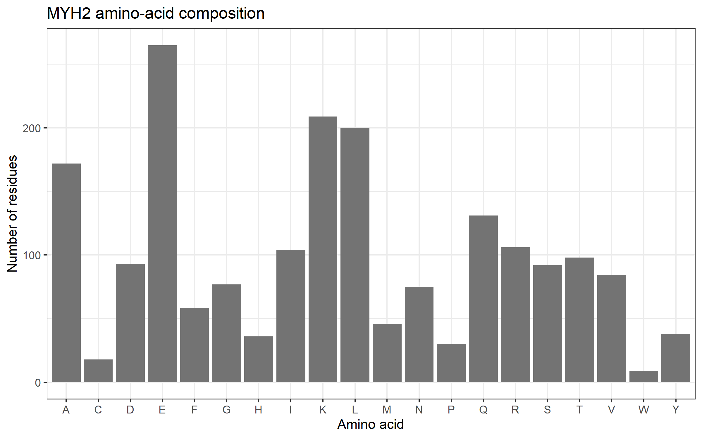
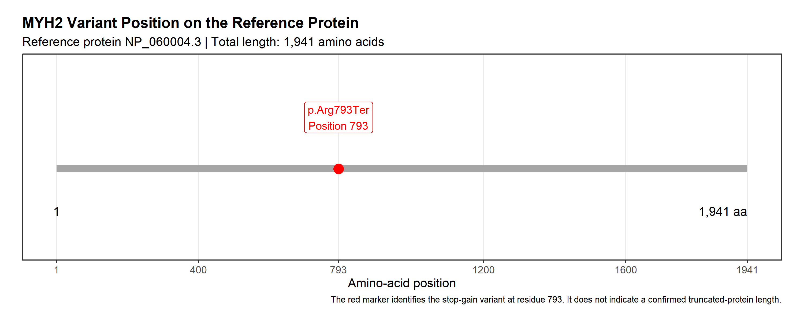

# Molecular Mechanisms of Muscle Contractility: MYH2

## 1. Assignment Information

- **Course:** BIO 300 — Cell and Molecular Biology
- **Assignment:** Assignment 04 
- **Gene symbol:** MYH2
- **NCBI Gene ID:** 4620
- **Organism:** *Homo sapiens*
- **Assigned transcript:** NM_017534.6
- **Matching RefSeq protein:** NP_060004.3
- **ClinVar Variation ID:** 625152
- **Assigned variant:** NM_017534.6:c.2377C>T (p.Arg793Ter)
- **R packages:** `rentrez`, `ggplot2`

## 2. Research Question

What does MYH2 encode, what is the amino-acid composition of its reference protein, and how might the assigned stop-gain variant affect myosin function and skeletal muscle contraction?

## 3. Objectives

1. Retrieve the human MYH2 gene record from NCBI.
2. Retrieve and save the protein sequence matching transcript NM_017534.6.
3. Calculate the reference protein length and amino-acid composition.
4. Generate an amino-acid composition bar plot and a protein-position plot.
5. Document the assigned ClinVar variant, classification, condition, review status, and supporting publications.
6. Explain the proposed molecular mechanism, distinguish clinical observations from functional evidence and predictions, and propose a validation experiment.

## 4. Software and Required Packages

This project uses R and RStudio. The `rentrez` package retrieves records from NCBI, and `ggplot2` generates figures. Base R functions are used for sequence processing, counting, and file handling.

Install the packages in a fresh R installation:

```r
install.packages(c("rentrez", "ggplot2"))
```

Load the packages:

```r
library(rentrez)
library(ggplot2)
```

Internet access is required for the NCBI retrieval steps.

## 5. Methods

### Step 1. Set up the project

The project contains `data`, `results`, and `figures` directories.

```r
gene_symbol <- "MYH2"
transcript_accession <- "NM_017534.6"
clinvar_id <- "625152"
variant_protein <- "p.Arg793Ter"

for (x in c("data", "results", "figures")) {
  dir.create(x, showWarnings = FALSE)
}
```

### Step 2. Retrieve the human gene record

The NCBI Gene database was searched using the gene symbol and human organism identifier. The exact MYH2 record was selected, and its gene name, Gene ID, official description, and chromosome were written to `results/gene_summary.txt`.

The search command was:

```r
hits <- entrez_search(
  db = "gene",
  term = paste0(
    gene_symbol,
    "[Gene Name] AND txid9606[Organism]"
  ),
  retmax = 20
)
```

The retrieved record identified MYH2 as Gene ID 4620, encoding myosin heavy chain 2, on chromosome 17.

### Step 3. Retrieve the matching protein sequence

The assigned transcript was retrieved from NCBI Nucleotide. The annotated protein accession was extracted from the transcript record, and the corresponding protein sequence was retrieved in FASTA format.

```r
gb <- entrez_fetch(
  db = "nuccore",
  id = transcript_accession,
  rettype = "gb",
  retmode = "text"
)

pat <- '/protein_id="NP_[0-9]+[.][0-9]+"'
fragment <- regmatches(gb, regexpr(pat, gb))

if (length(fragment) == 0 || fragment == "") {
  stop("NP protein ID not found; inspect the transcript record")
}

protein_accession <- gsub(
  '^/protein_id="|"$',
  "",
  fragment
)

protein_fasta <- entrez_fetch(
  db = "protein",
  id = protein_accession,
  rettype = "fasta",
  retmode = "text"
)

fasta_file <- file.path(
  "data",
  paste0(gene_symbol, "_protein.fasta")
)

writeLines(protein_fasta, fasta_file)
```

The matching protein accession was **NP_060004.3**. The sequence was saved to `data/MYH2_protein.fasta`.

### Step 4. Calculate protein length and amino-acid composition

The FASTA header was excluded, and the sequence lines were combined into one sequence. The protein length and counts of the 20 standard amino acids were calculated.

```r
fasta_lines <- readLines(fasta_file)

sequence <- paste(
  fasta_lines[!grepl("^>", fasta_lines)],
  collapse = ""
)

aa <- strsplit(toupper(sequence), "")[[1]]
protein_length <- length(aa)

standard <- strsplit(
  "ACDEFGHIKLMNPQRSTVWY",
  ""
)[[1]]

counts <- table(factor(aa, levels = standard))

results <- data.frame(
  AminoAcid = standard,
  Count = as.integer(counts)
)

write.csv(
  results,
  "results/amino_acid_composition.csv",
  row.names = FALSE
)
```

The amino-acid counts were visualized using `ggplot2` and saved as `figures/01_amino_acid_composition.png`.

### Step 5. Document the assigned ClinVar variant

The assigned variant was reviewed at:

https://www.ncbi.nlm.nih.gov/clinvar/variation/625152/

The variant name, transcript, HGVS notation, variant type, associated condition, aggregate classification, review status, record dates, and cited publications were documented.

The original assigned variant was retained throughout the analysis.

### Step 6. Generate the variant-position plot

The assigned variant was mapped to amino-acid position 793 on the reference protein containing 1,941 amino acids. The figure was generated using `ggplot2` and saved as `figures/02_variant_position.png`.

The marker indicates the variant position in the reference sequence. It does not demonstrate that a truncated protein is produced or establish its final length.

### Step 7. Optional functional-domain visualization

An additional functional-domain map was generated to show the annotated regions of the MYH2 reference protein and the position of the assigned variant. The reference protein, NP_060004.3, contains 1,941 amino acids. The red dashed line marks the position of the p.Arg793Ter variant at residue 793.

The figure was saved as `figures/03_functional_domain_map.png`. Domain boundaries must be verified against an authoritative protein annotation database, such as UniProt, before the colored regions are interpreted as confirmed annotations. This figure is a schematic domain map, not an experimentally determined three-dimensional protein structure.

The domain boundaries were checked against the conserved-domain annotations in the NCBI MYH2 Gene record (Gene ID 4620). The figure is a schematic representation of the annotated domains, not an experimentally determined three-dimensional protein structure.

## 6. Results

### 6.1 Gene and protein retrieval

| Item | Result |
|---|---|
| Gene | MYH2 |
| NCBI Gene ID | 4620 |
| Chromosome | 17 |
| Transcript | NM_017534.6 |
| RefSeq protein | NP_060004.3 |
| Protein length | 1,941 amino acids |

### 6.2 Amino-acid composition

The three most abundant amino acids in the retrieved reference sequence were:

| Amino acid | Count |
|---|---:|
| Glutamic acid (E) | 265 |
| Lysine (K) | 209 |
| Leucine (L) | 200 |

These values describe the composition of the retrieved sequence. Amino-acid frequency alone cannot establish protein activity, prove a variant's effect, or measure actin binding, ATPase activity, or muscle force.

### 6.3 ClinVar record

| Field | Result |
|---|---|
| Variant name | NM_017534.6(MYH2):c.2377C>T (p.Arg793Ter) |
| Transcript | NM_017534.6 |
| Coding DNA change | c.2377C>T |
| Protein consequence | p.Arg793Ter; also displayed as p.Arg793* |
| Variant type | Single-nucleotide variant |
| Molecular consequence | Nonsense / stop-gain |
| ClinVar Variation ID | 625152 |
| Aggregate classification | Pathogenic |
| Aggregate submission count | Three contributing submissions |
| Associated condition | Myopathy, proximal, and ophthalmoplegia (two submissions); one submission lists no condition |
| Aggregate review indicator | Three stars shown in the accessed ClinVar record |
| First recorded in ClinVar | April 11, 2019 |
| Last submission shown | February 23, 2026 |
| Last evaluation shown | August 11, 2023 |
| Access date | October 28, 2026 |

The aggregate classification and the review status of individual submissions are different pieces of information. The three-star aggregate indicator should not be interpreted as meaning that all three individual submissions have the same review status.

### 6.4 Figures

**Figure 1. Amino-acid composition of MYH2.**



This bar plot shows the counts of the 20 standard amino acids in the MYH2 reference protein.

**Figure 2. MYH2 variant position on the reference protein.**



This plot marks residue 793, the position associated with p.Arg793Ter, on the 1,941-amino-acid reference protein. The marker does not establish the actual length of any resulting altered protein.

**Figure 3. MYH2 functional-domain map.**


This schematic shows the annotated functional regions of the MYH2 reference protein and the location of the assigned variant. Domain boundaries must be checked against the cited database annotation before being treated as confirmed.

## 7. Discussion: Molecular Mechanism, Evidence, and Limitations

MYH2 encodes myosin heavy chain 2, a motor protein expressed in fast-twitch skeletal muscle fibers. It forms part of the thick filament and interacts with actin during the actin–myosin cross-bridge cycle. Myosin hydrolyzes ATP to generate force, directly contributing to skeletal muscle contraction. MYH2 therefore primarily participates in force generation rather than acting as a direct regulator of intracellular calcium.

The assigned variant, NM_017534.6:c.2377C>T (p.Arg793Ter), is a nonsense variant. The nucleotide substitution introduces a premature termination codon at residue 793. This sequence consequence supports the prediction that normal full-length myosin production may be disrupted. However, the sequence notation does not establish whether the altered messenger RNA is degraded through nonsense-mediated decay or whether an incomplete protein accumulates.

The ClinVar record classifies the variant as pathogenic and associates it with proximal myopathy and ophthalmoplegia. It shows three contributing submissions. Telese et al. (2020) reported this variant in a patient who also carried a second truncating MYH2 variant, p.Glu1461Ter. Their study included genetic confirmation, clinical observations, muscle biopsies, and transcript-expression analysis. The authors detected both mutated alleles in the patient's muscle cDNA. These are experimental observations in a patient carrying two variants; they do not independently establish the isolated biochemical effect of p.Arg793Ter.

The ClinVar submission comments do not establish a direct functional assay demonstrating the isolated effect of this specific variant. Therefore, the premature stop codon is supported by sequence annotation, and the clinical association is supported by the reported patient and variant classifications, but the precise effect on myosin motor activity remains uncertain.

The proposed causal chain is **MYH2 → myosin heavy chain 2 → actin–myosin force generation → p.Arg793Ter premature stop codon → possible reduction or impairment of functional myosin → impaired skeletal muscle contraction**. This is a mechanistic interpretation, not proof that a truncated protein is produced.

A possible validation experiment is an actin-filament motility assay comparing normal MYH2 myosin with a validated variant model, if the variant protein can be produced. Fluorescence microscopy could measure actin-filament movement in the presence of ATP. Reduced movement would support impaired motor function. If the variant protein is not produced, RNA-expression and protein-detection experiments could help test whether the altered transcript is degraded or protein abundance is reduced.

## 8. Limitations and Possible Validation Experiment

1. Amino-acid composition describes sequence frequencies and does not directly measure protein function.
2. The variant-position figure shows a reference-sequence location, not a proven truncated-protein length.
3. A pathogenic clinical classification does not by itself demonstrate the variant's isolated biochemical effect.
4. The cited patient carried two truncating MYH2 variants, limiting conclusions about the independent effect of p.Arg793Ter.
5. The exact RNA and protein consequences of the assigned variant remain uncertain.
6. Any optional domain schematic must use verified domain annotations and a clear source citation.

**Proposed experiment:** Perform an actin-filament motility assay using normal myosin and an appropriate variant model, with ATP and matched experimental controls. Quantify filament movement by fluorescence microscopy. Reduced movement would support impaired motor function, but failure to produce a stable variant protein would require complementary RNA-expression or protein-abundance experiments.

## 9. Answers to the Required Questions

### Question 1. What does your assigned gene encode, and how does this protein contribute to muscle function?

MYH2 encodes myosin heavy chain 2, a motor protein in fast-twitch skeletal muscle thick filaments. It interacts with actin and uses ATP to generate force during contraction.

### Question 2. What was the exact protein accession and length retrieved with R?

The matching RefSeq protein accession was **NP_060004.3**, and the retrieved sequence contained **1,941 amino acids**.

### Question 3. What did the amino-acid composition chart show? What can it NOT tell you?

Glutamic acid (E) was the most abundant residue (265), followed by lysine (K; 209) and leucine (L; 200). The chart describes sequence composition but cannot demonstrate protein activity, molecular interactions, or the functional impact of the variant.

### Question 4. What is your fixed ClinVar variant, and what is its current classification and evidence strength?

The fixed variant is NM_017534.6:c.2377C>T (p.Arg793Ter), ClinVar Variation ID 625152. The accessed record classified it as pathogenic and displayed three contributing submissions with a three-star aggregate review indicator. The individual submissions had different review levels, and clinical classification should not be confused with direct functional proof.

### Question 5. What is the scientifically supported mechanism linking this variant to muscle function, and what remains uncertain?

The variant introduces a premature stop codon at residue 793, which may disrupt production of normal full-length myosin. Reduced transcript abundance through nonsense-mediated decay or production of an incomplete protein are possible outcomes. The exact protein-level effect and isolated impact on motor activity remain uncertain.

### Question 6. What additional experiment would help test the proposed mechanism?

An actin-filament motility assay could compare movement generated by normal myosin and a validated variant model. Fluorescence microscopy would quantify filament movement under controlled ATP conditions. RNA-expression and protein-detection assays could be used if the variant protein cannot be produced.

## 10. Database Links and Access Dates

Record the date on which each database is actually checked. The ClinVar screenshot reviewed for this project was accessed on October 28, 2026. Other dates below should be filled in after checking the corresponding records.

| Database | Record | Link | Access date |
|---|---|---|---|
| NCBI Gene | MYH2, Gene ID 4620 | https://www.ncbi.nlm.nih.gov/gene/4620 | [October 28, 2026 |
| NCBI Nucleotide | NM_017534.6 | https://www.ncbi.nlm.nih.gov/nuccore/NM_017534.6 | October 28, 2026 |
| NCBI Protein | NP_060004.3 | https://www.ncbi.nlm.nih.gov/protein/NP_060004.3 | October 28, 2026 |
| NCBI ClinVar | Variation ID 625152 | https://www.ncbi.nlm.nih.gov/clinvar/variation/625152/ | October 28, 2026 |
| UniProt | MYH2, P13535; consult for domain annotations if used | https://www.uniprot.org/uniprotkb/P13535/entry |October 28, 2026 |
| rentrez documentation | R package documentation | https://docs.ropensci.org/rentrez/ | October 28, 2026 |

## 11. References

1. Telese, R., et al. (2020). *MYH2 myopathy, a new case expands the clinical and pathological spectrum of the recessive form.* Molecular Genetics & Genomic Medicine, 8(9), e1320. https://doi.org/10.1002/mgg3.1320. PMID: 32578970.

2. Tajsharghi, H., et al. (2014). *Recessive myosin myopathy with external ophthalmoplegia associated with MYH2 mutations.* European Journal of Human Genetics. https://pubmed.ncbi.nlm.nih.gov/24193343/

3. Lossos, A., et al. (2013). *MYH2 mutation in recessive myopathy with external ophthalmoplegia linked to chromosome 17p13.1-p12.* Brain. https://pubmed.ncbi.nlm.nih.gov/23388406/

4. Tajsharghi, H., et al. (2010). *Human disease caused by loss of fast IIa myosin heavy chain due to recessive MYH2 mutations.* Brain. https://pubmed.ncbi.nlm.nih.gov/20418530/

5. NCBI ClinVar. *MYH2 variant NM_017534.6:c.2377C>T (p.Arg793Ter).* Variation ID 625152. https://www.ncbi.nlm.nih.gov/clinvar/variation/625152/

6. National Center for Biotechnology Information (NCBI). *MYH2 myosin heavy chain 2 [Homo sapiens].* NCBI Gene, Gene ID 4620. https://www.ncbi.nlm.nih.gov/gene/4620. Used to verify the functional-domain coordinates shown in Figure 3.

## 12. Reproduction Instructions

1. Install R and RStudio.
2. Download or clone this repository.
3. Open the project folder in RStudio.
4. Install `rentrez` and `ggplot2` if needed.
5. Open `analysis.R`.
6. Run the complete script using **Source**.
7. Check the `data`, `results`, and `figures` directories for the output files.

The analysis requires internet access for NCBI retrieval. If an NCBI request fails temporarily, rerun only the failed step rather than changing the assigned gene or variant. Package build-version warnings may appear when a package was built under a different R version; these should be distinguished from errors that stop execution.

The final `analysis.R` file must contain all executable commands required to regenerate the submitted outputs. The methods documented here should be checked against that final script before publication.


## 13. Scientific Note

This project uses publicly available gene, protein, and variant records for educational purposes. Sequence-based predictions, clinical associations, and experimentally observed results are reported as distinct types of evidence. The analysis is not a clinical diagnostic report.
